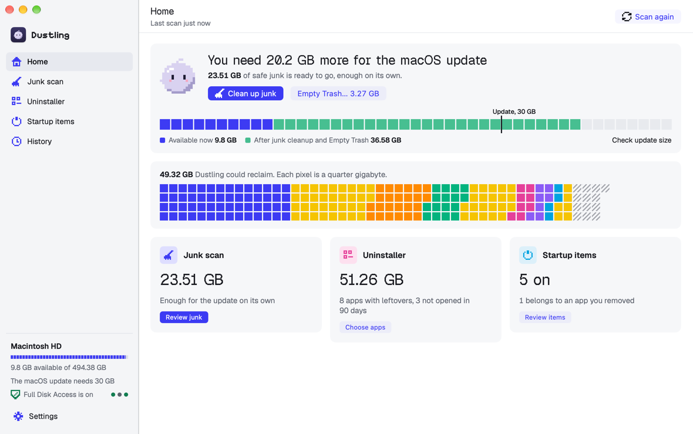
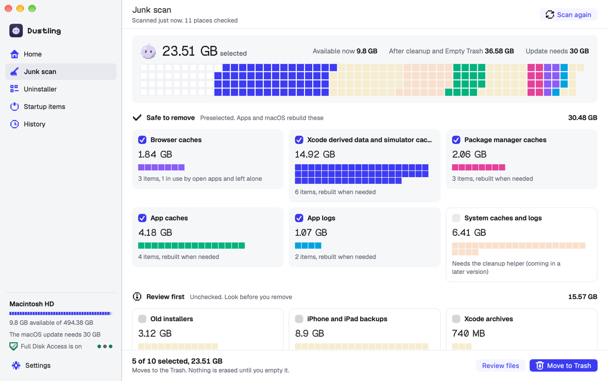
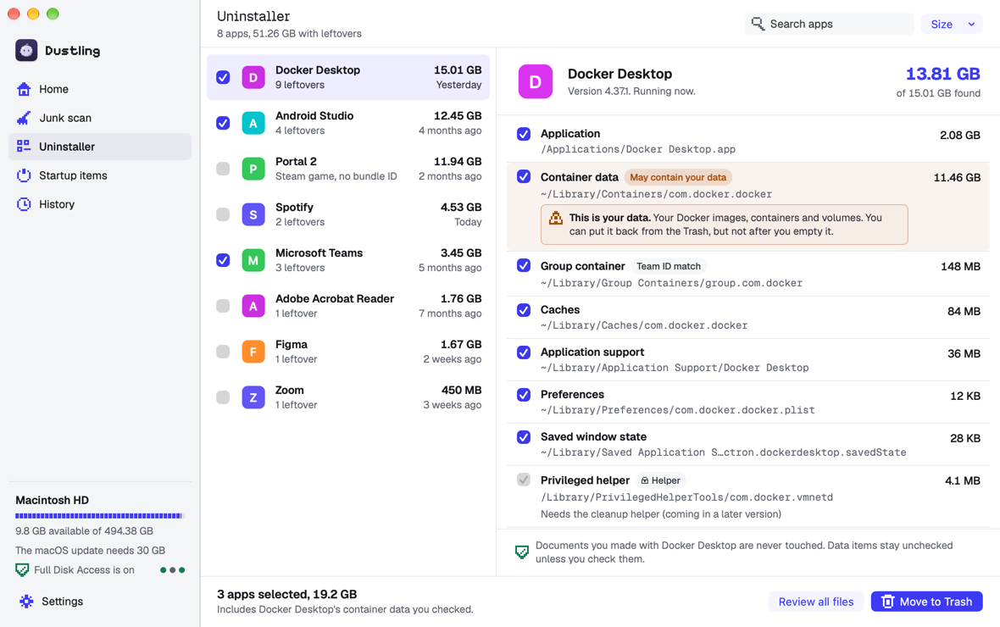
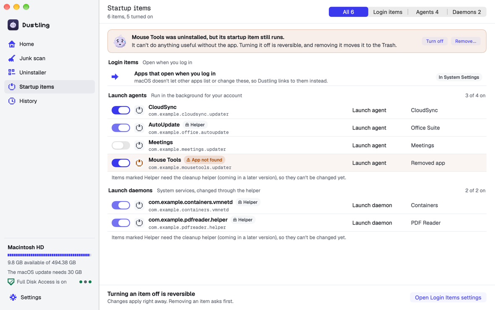
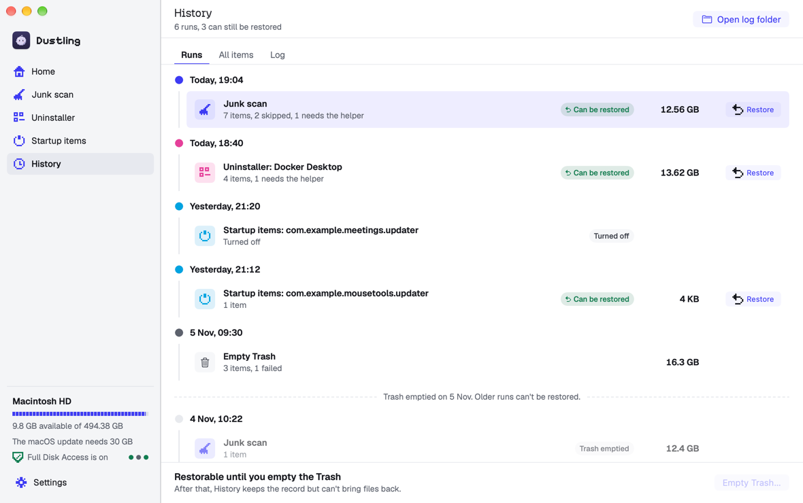

<p align="center">
  <picture>
    <source media="(prefers-color-scheme: dark)" srcset="docs/assets/dustling-lockup-dark.svg">
    
  </picture>
</p>

<p align="center">
  <strong>A free, open-source Mac cleaner that never fails silently.</strong>
</p>

<p align="center">
  
  
  
</p>

---

Dustling finds what's filling your Mac and clears it safely. It finds caches, logs, old installers, app leftovers and startup clutter, and tells you exactly what happened to every single file.

It started with a full disk that blocked a macOS update, and a cleaner that sometimes did nothing at all, without saying so. Dustling is built around the opposite promise. If it can't look somewhere, it says so. If it can't remove something, it tells you why. Nothing is ever deleted that you didn't see first.

<p align="center">
  <a href="https://github.com/kaankuzu1/dustling/releases/latest/download/Dustling.dmg"><strong>Download Dustling.dmg</strong></a>
  &nbsp;·&nbsp; macOS 14 or later &nbsp;·&nbsp;
  <a href="CHANGELOG.md">What's new</a>
</p>

> **Dustling isn't signed with an Apple Developer ID yet,** so macOS asks you to confirm the first time you open it. [Installing Dustling](docs/INSTALL.md) shows how. Apps and leftovers that belong to the system, such as an installer's app or a launch daemon, move to the Trash with your Mac password; switching system startup items on or off waits for the admin helper (see the [roadmap](#roadmap)). System caches and logs are never cleaned: macOS manages them.

<p align="center">
  <picture>
    <source media="(prefers-color-scheme: dark)" srcset="docs/screenshots/home-dark.png">
    
  </picture>
</p>

## Contents

- [What it does](#what-it-does)
- [Safety promises](#safety-promises)
- [Screenshots](#screenshots)
- [Install](#install)
- [Getting started](#getting-started)
  - [Build the app](#build-the-app)
- [Command line](#command-line)
- [What Dustling cleans](#what-dustling-cleans)
- [How it works](#how-it-works)
- [Roadmap](#roadmap)
- [Contributing](#contributing)
- [License](#license)

## What it does

- **Junk scan.** Groups what it finds into categories, with sizes. Safe-to-regenerate caches and logs are picked by default. Personal files, like big old downloads or installers, are only ever shown for you to review.
- **App uninstaller.** Removes an app together with its leftovers: caches, preferences, containers, launch agents and more. Anything that may hold *your* data (saves, libraries, databases) is listed but left unchecked. It also handles apps that other cleaners skip, such as Steam game shortcuts with no bundle ID.
- **Startup items.** Lists login agents and background daemons, and lets you turn user-level ones off and on again.
- **History and Restore.** Every run is recorded. Changed your mind? Put a whole cleanup back, or just one file, as long as it's still in the Trash.
- **Health check.** Verifies Full Disk Access by actually trying to read a protected location, and shows free space the same way the macOS updater counts it, including "purgeable" space macOS frees on its own.

## Screenshots

| Junk scan | Uninstaller |
| --- | --- |
| <picture><source media="(prefers-color-scheme: dark)" srcset="docs/screenshots/junk-results-dark.png"></picture> | <picture><source media="(prefers-color-scheme: dark)" srcset="docs/screenshots/uninstaller-detail-dark.png"></picture> |

| Startup items | History |
| --- | --- |
| <picture><source media="(prefers-color-scheme: dark)" srcset="docs/screenshots/startup-normal-dark.png"></picture> | <picture><source media="(prefers-color-scheme: dark)" srcset="docs/screenshots/history-runs-dark.png"></picture> |

Every screen, in light and dark, is in [`docs/screenshots`](docs/screenshots). They show sample data from Dustling's screenshot fixtures, not anyone's real files.

## Safety promises

| Promise | What it means in practice |
| --- | --- |
| **Trash first** | Cleaning and uninstalling only *move* things to the Trash. Emptying the Trash is the single permanent delete, and it always asks first. |
| **Never fail silently** | Every item gets an outcome: `moved to Trash`, `skipped: <reason>`, `failed: <reason>`, `needs admin` or `deleted`. Totals come from what actually happened. Every run is written to a log and to History. |
| **No fake zeros** | A folder Dustling isn't allowed to read shows as "couldn't scan (needs Full Disk Access)", never as "0 bytes". |
| **See it before it goes** | Review categories and Trash contents are listed item by item before you confirm. |
| **Protected places stay protected** | Documents, Desktop, Pictures, Music, Movies, iCloud Drive, cloud storage folders, Keychains, Mail, system folders and other users' files are off limits, including through symlinks and lookalike spellings. |
| **Open apps are left alone** | Caches of apps that are currently running are skipped and reported. |
| **No network, no tracking** | Dustling never needs the internet to clean, and it collects no analytics. No account required. |

## Install

Download **[Dustling.dmg](https://github.com/kaankuzu1/dustling/releases/latest/download/Dustling.dmg)**, open it and drag Dustling to Applications. Because it isn't signed with an Apple Developer ID yet, the first time you open it:

- **macOS 15 Sequoia or later:** click **Done**, then go to **System Settings → Privacy & Security** and click **Open Anyway** next to "Dustling was blocked".
- **macOS 14 Sonoma:** Control-click Dustling in Applications and choose **Open**.

[Installing Dustling](docs/INSTALL.md) covers updating, checking the download and uninstalling. Every version is listed in the [changelog](CHANGELOG.md) and on the [Releases](https://github.com/kaankuzu1/dustling/releases) page.

## Getting started

To run the command-line tool or build the app from source:

**Requirements:** macOS 14 Sonoma or newer, and Xcode 26 or later (Swift 6). See [Build the app](#build-the-app) for the Mac app.

```bash
git clone https://github.com/kaankuzu1/dustling.git
cd dustling
swift build
```

```bash
swift run dustling-cli doctor
```

### Give it Full Disk Access

macOS hides many caches, Mail downloads, iPhone backups and the Trash itself behind Full Disk Access. Without it, Dustling still works but reports those places as "couldn't scan".

1. Open **System Settings → Privacy & Security → Full Disk Access**. You can also run `open "x-apple.systempreferences:com.apple.preference.security?Privacy_AllFiles"`.
2. Turn it on for the terminal app you run Dustling from (Terminal, iTerm, Ghostty and so on).
3. Quit and reopen that terminal, then run `swift run dustling-cli doctor` again.

### Free up space

```bash
swift run dustling-cli scan          # see what's there, nothing changes
swift run dustling-cli clean         # move the default categories to the Trash (asks first)
swift run dustling-cli empty-trash   # actually free the space (asks first)
```

Something went missing? `swift run dustling-cli history` shows every run, and `restore` puts items back.

### Build the app

The Mac app lives in `App/`. You need:

- Xcode 26 or later. The app icon is an Icon Composer file, which older Xcode versions can't build.
- [XcodeGen](https://github.com/yonaskolb/XcodeGen): `brew install xcodegen`.

```bash
cd App
xcodegen generate
open Dustling.xcodeproj
```

Then choose the **Dustling** scheme and press Run (⌘R). To build from the command line instead:

```bash
xcodebuild -project Dustling.xcodeproj -scheme Dustling -configuration Debug -derivedDataPath build build
open build/Build/Products/Debug/Dustling.app
```

The generated project and `build/` are not checked in; change `App/project.yml` instead. The first time Dustling opens, it walks you through Full Disk Access. Without it, the app still works and says which places it couldn't read.

[App/README.md](App/README.md) covers signing with your own team (so macOS keeps Full Disk Access across rebuilds) and building from a folder that iCloud Drive syncs (Desktop or Documents).

## Command line

`dustling-cli` is a front end for the core engine. Run it with `swift run dustling-cli <command>`.

It uses the Mac app's scan settings when the app has saved them (the `app.dustling.Dustling` defaults): folders excluded in the app's Settings are never scanned or moved by the CLI either. Without saved settings it uses the defaults.

| Command | What it does |
| --- | --- |
| `doctor` | Full Disk Access status, free and purgeable space, snapshot count, problems (exit 1 if any) |
| `scan` | Categories with size and item count (`couldn't scan` or `at least` when something couldn't be read); `[review]`, `[left alone]` and `[trash]` mark ones that are not ticked by default; separate totals for what's cleanable by default, review items, what Dustling leaves alone and the Trash |
| `clean [--include <categoryID>...]` | Moves the default categories (plus any you include, each item listed first) to the Trash. System caches and logs are never cleaned: `--include systemCachesAndLogs` is refused |
| `apps` | Numbered list of installed apps with sizes; a symlinked app shows where it points |
| `uninstall <name\|number> [--all]` | Moves an app and its checked leftovers to the Trash; `--all` also moves unchecked ones |
| `startup`, `startup disable\|enable <label>` | Lists login items and background agents, or turns one off or on |
| `history` | Past runs, with a `restorable` marker |
| `restore <run-id-prefix> [--path <p>]` | Lists a run's items (or one path) and puts them back from the Trash |
| `empty-trash` | Lists what's in the Trash, then permanently deletes it |

**Confirmations:**
- Every command that changes something asks first (`[y/N]`).
- Anything but `y` or `yes` cancels, prints `Cancelled.` and exits 0.
- Without a terminal the answer is no, unless you pass `--yes`.

**Exit codes:**

| Code | Meaning |
| --- | --- |
| 0 | Success |
| 1 | Usage error, `doctor` found problems, or nothing the command can act on: a run with nothing left to restore, a path that isn't in the run, or a Trash Dustling can't read |
| 2 | An item failed or needs admin rights |

Logs are written to `~/Library/Logs/Dustling/` and run history to `~/Library/Application Support/Dustling/History/`.

## What Dustling cleans

| Category | ID | Default |
| --- | --- | --- |
| Browser caches (Safari, Chrome, Firefox, Edge, Brave, Arc), caches only, never history, cookies or passwords | `browserCaches` | picked |
| Xcode build data (DerivedData and simulator caches) | `xcodeJunk` | picked |
| Package manager caches (Homebrew, npm, pip, CocoaPods, Yarn) | `packageManagerCaches` | picked |
| App caches, including sandboxed apps' caches | `userCaches` | picked |
| App logs | `userLogs` | picked |
| System caches and logs (shown for their size only) | `systemCachesAndLogs` | never cleaned: macOS manages them |
| Old installers (`.dmg` / `.pkg` in Downloads) | `oldInstallers` | review |
| Large or old downloads (≥ 500 MB, or not opened in 90 days) | `largeOldDownloads` | review |
| iPhone and iPad backups | `iosBackups` | review |
| Xcode archives | `xcodeArchives` | review |
| Mail downloads | `mailDownloads` | review |
| What's already in the Trash | `trash` | only via `empty-trash` |

## How it works

Dustling is a Swift package:

- **`DustlingCore`** is the engine, with no UI.
  - **Safety:** protected paths, applied to every move.
  - **Scanning:** the category catalog and an allocated-size measurer that never follows symlinks.
  - **Cleanup:** the Trash mover, the cleanup runner and Empty Trash.
  - **History:** the run journal (with file identity checks for safe restores) and human-readable logs.
  - **Uninstaller:** app discovery and leftover matching.
  - **Startup:** launch agent and daemon scanning.
  - **Health:** the Full Disk Access probe and storage numbers.
- **`dustling-cli`** is a thin command-line layer over the engine.

Design notes live in [`docs/superpowers`](docs/superpowers):
- the [design spec](docs/superpowers/specs/2026-11-07-dustling-design.md);
- the [core engine plan](docs/superpowers/plans/2026-11-07-dustling-core-engine.md);
- the [decisions made while building it](docs/superpowers/rulings/2026-11-07-core-engine-rulings.md).

## Roadmap

- [x] **Core engine and command-line tool.** Junk scan, uninstaller, startup items, History and Restore, health check.
- [x] **The Mac app.** A SwiftUI interface with Dustling's "Mosaic" design: a mosaic view of your storage, live scanning, per-item progress and a guided Full Disk Access setup. Motion respects Reduce Motion, and the app supports VoiceOver and keyboard navigation.
- [x] **Your Mac password for what belongs to the system.** Apps an installer put in Applications, launch daemons and other leftovers of the system move to the Trash (and back, and out of the Trash) with the standard macOS password box, once per action. Package receipts stay where they are, and System caches and logs are never cleaned.
- [ ] **Admin helper.** A small privileged helper (via `SMAppService`) for switching system startup items (launch daemons and system launch agents) on and off. It repairs itself if macOS unregisters it.
- [x] **Releases.** Versioned releases with a `.dmg` on GitHub Releases, a [changelog](CHANGELOG.md), and a website at [dustling.app](https://dustling.app).
- [ ] **Signing.** A Developer ID signature and notarization, so macOS opens Dustling without asking, and a Homebrew cask.

## Contributing

Issues and pull requests are welcome.

```bash
swift build
swift test
```

- Tests run in temporary sandboxes and never touch your real home folder, Trash or launchd. Please keep it that way.
- New behavior comes with a test that fails without it.
- Changes people will notice get a line under `## [Unreleased]` in [CHANGELOG.md](CHANGELOG.md). [docs/RELEASING.md](docs/RELEASING.md) explains versions and releases.
- Anything that moves or deletes files must go through `TrashMover`, which applies the protected-path rules, and must produce an explicit outcome.

## License

[MIT](LICENSE). Dustling is an independent project and isn't affiliated with any other cleaner app.
